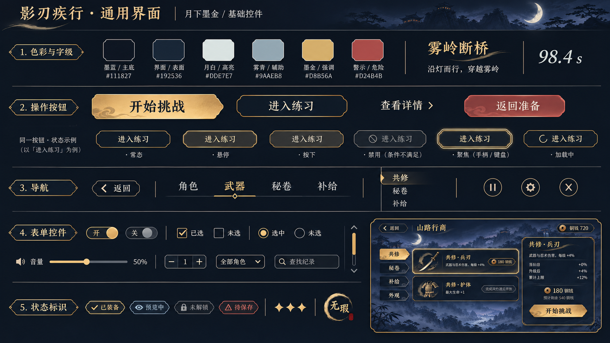
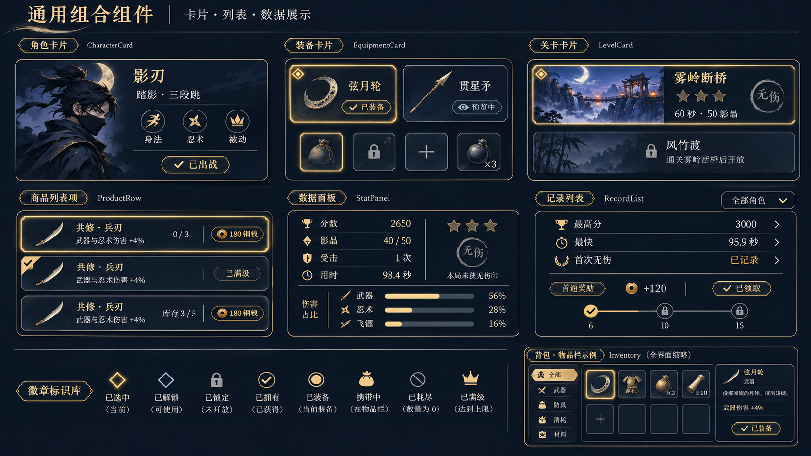
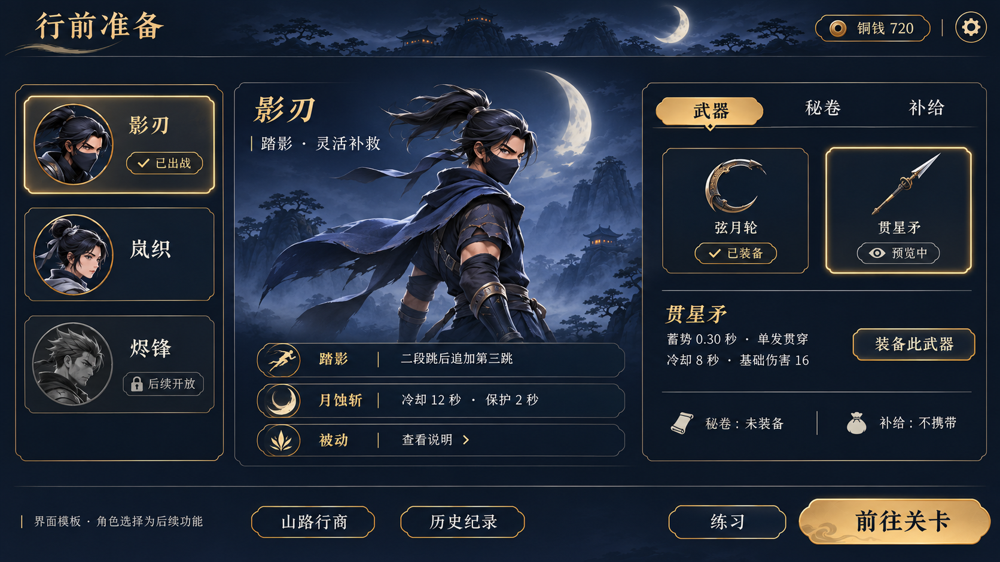
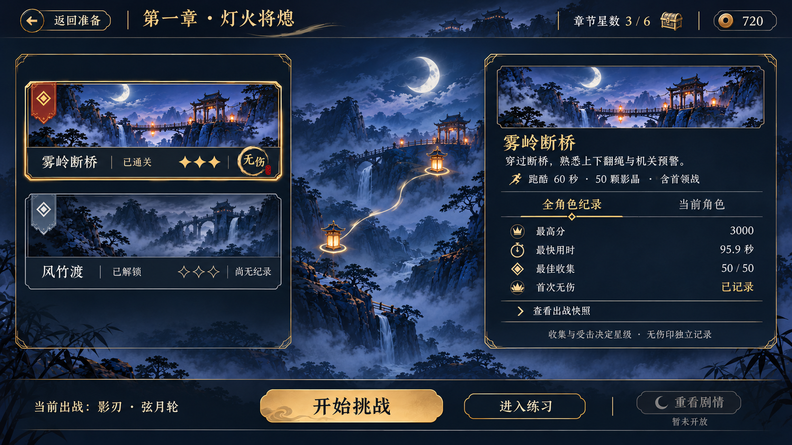
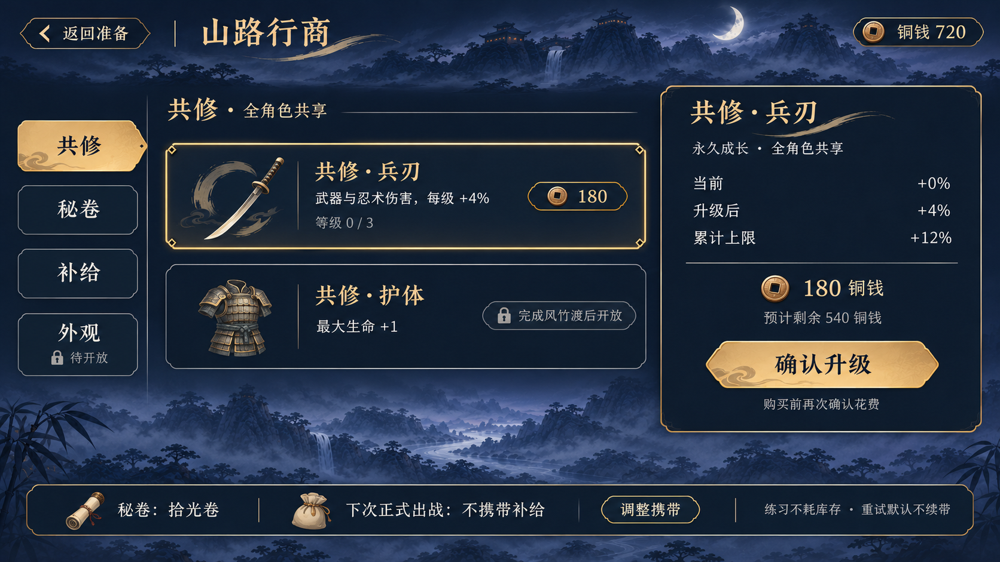
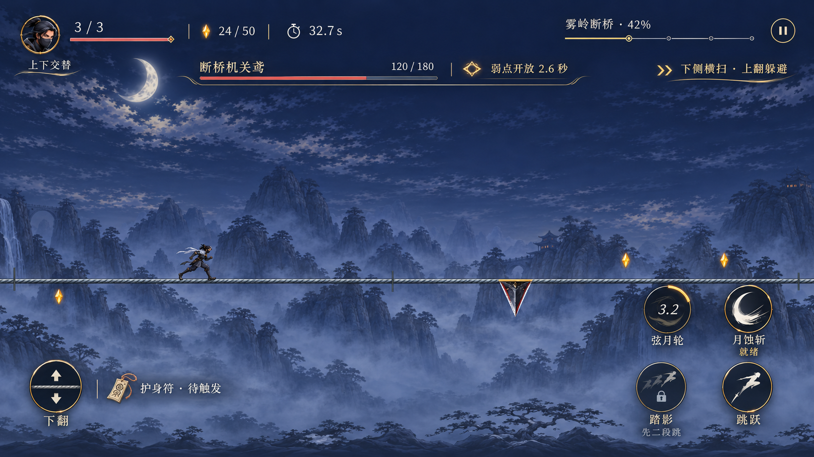
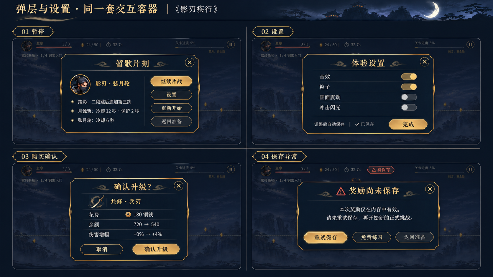
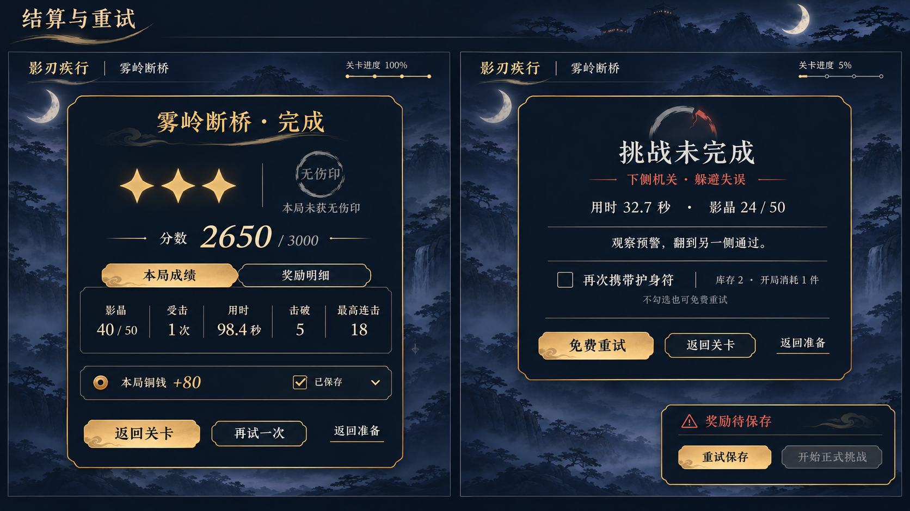
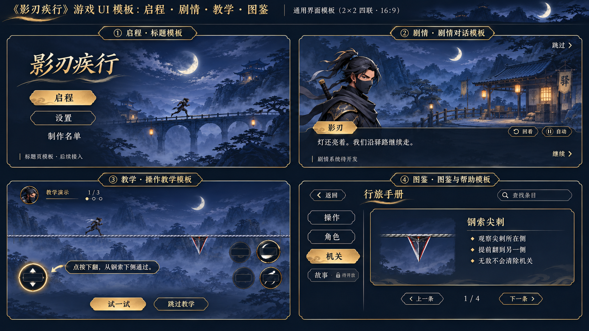
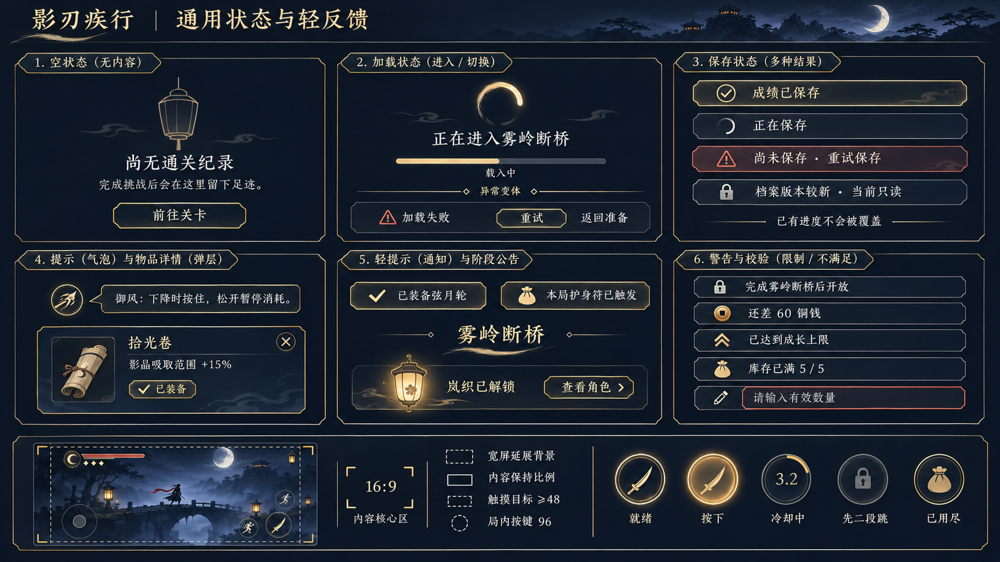

# 通用 UI 概念图册 · 月下墨金 v01

2026-11-06 · **用户概念审核通过（2026-11-06），通用主题已用于商店 / 设置，第二批卡片 / 页签 / 详情已接入正式行前准备；运行时视觉与 Android 另行验收。**

10 张原始概念板，61 类控件设计，12 组界面模板。后续 UI 优先复用或扩展本体系。

[离线浏览图册](index.html) · [设计规范](../../../../../docs/UI_DESIGN_SYSTEM.md) · [任务卡](../../../../validation/ui/common/v01/README.md) · [提示词](../../../../prompts/ui/common/v01/generation.prompt.md) · [原图清单](manifest.json) · [Godot 实际截图](../../../../validation/ui/common/v01/runtime/README.md)

示例值、生成文字、角色立绘与状态组合不替代真实数据；制作修正见规范第 9 节。

## 01 · 基础控件

按钮、导航、表单、字级与色彩。

制作说明：朱砂值与普通返回样式以规范为准。

## 02 · 组合组件

角色、装备、关卡、商品、纪录、奖励与背包。

制作说明：成长与库存示例分别绑定对应商品类型；星形需加强填充辨识。

## 03 · 行前准备

角色选择、能力与装备详情，预览和装备分开。

制作说明：角色选择与专属立绘为后续模板；武器文字取实际配置。

## 04 · 章节与关卡

驿灯路线、关卡状态、纪录与挑战入口。

制作说明：3/6 是可达示意，章节目标仍为15；总目标从目录读取。

## 05 · 山路行商

共修、秘卷、补给、详情与携带摘要。

制作说明：按真实档位、余额、库存、所有权显示；外观保持待开放。

## 06 · 战斗与首领 HUD

悬浮信息、一左四右、冷却与被动道具。

制作说明：几何按既有ScreenLayout；首领弱点与攻击预警为分开的状态示例。

## 07 · 弹层与设置

暂停、四项设置、购买确认、保存异常。

制作说明：购买确认只在商店；模型错字由Godot原生文案替换。

## 08 · 结算与重试

三星与独立无伤、成绩、奖励、失败与免费重试。

制作说明：奖励金额为排版示例；再次携带为后续功能，未实现不启用。

## 09 · 标题、剧情与手册

启程、对话、操作教学、图鉴与帮助模板。

制作说明：本板为后续模板；教学的障碍侧别必须与指引对应。

## 10 · 状态与轻反馈

空态、加载、保存、提示、解锁、校验与安全区。

制作说明：无真实进度时使用不定条；缩略图装饰摇杆不纳入本游戏。
