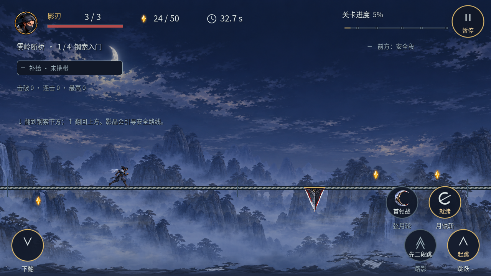
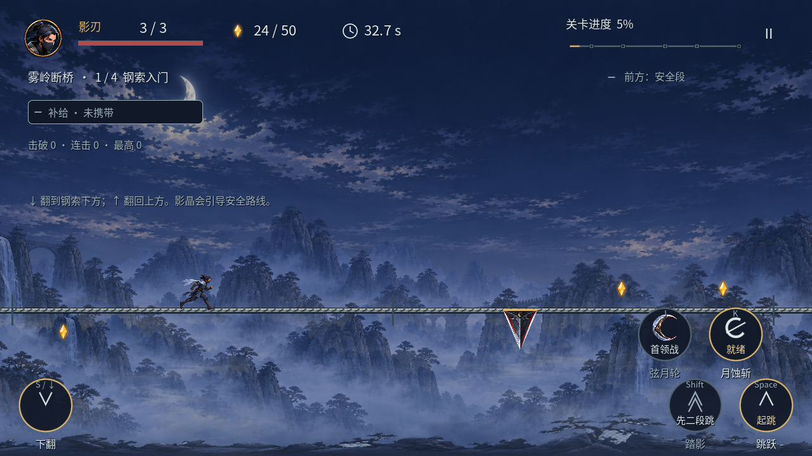
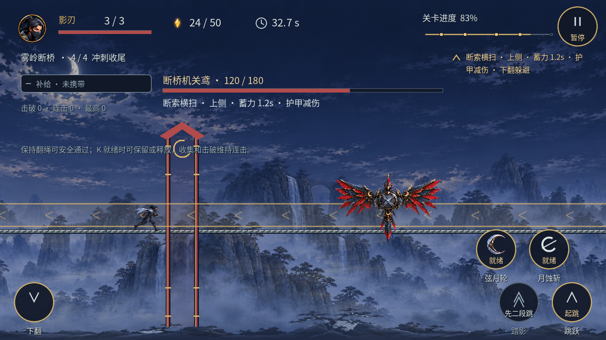
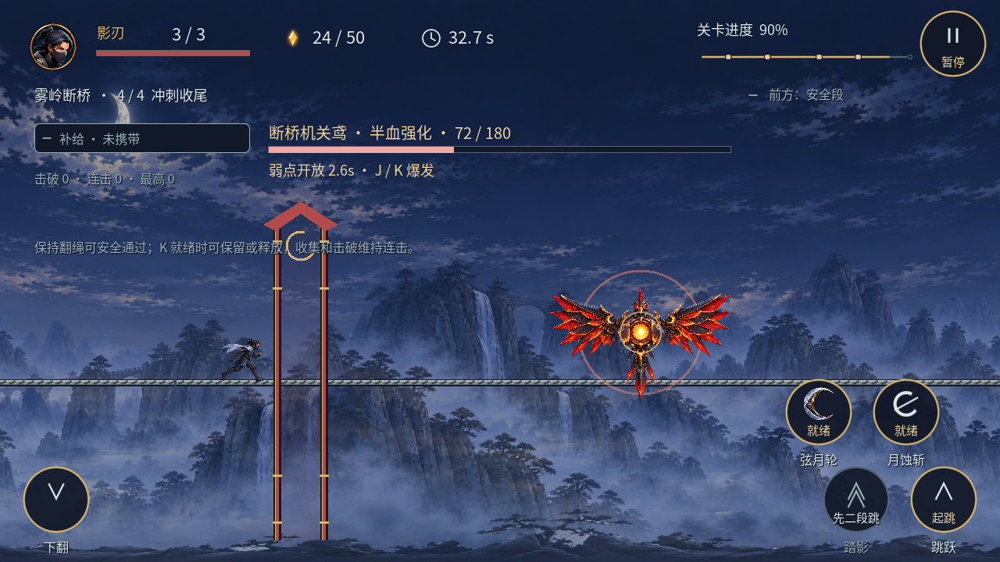
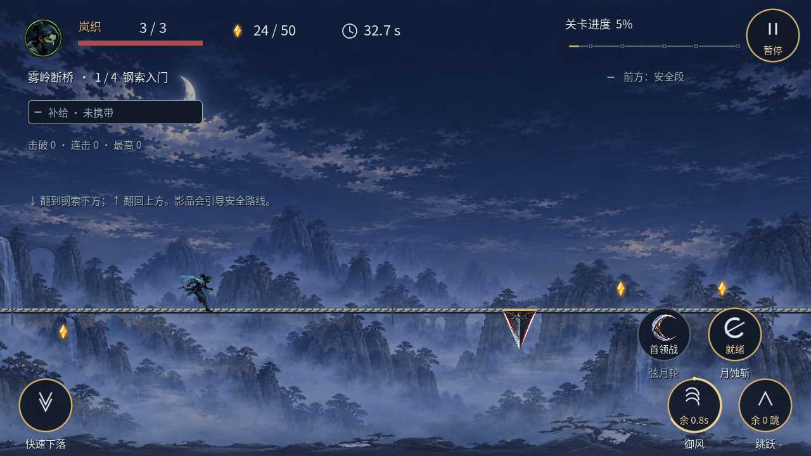
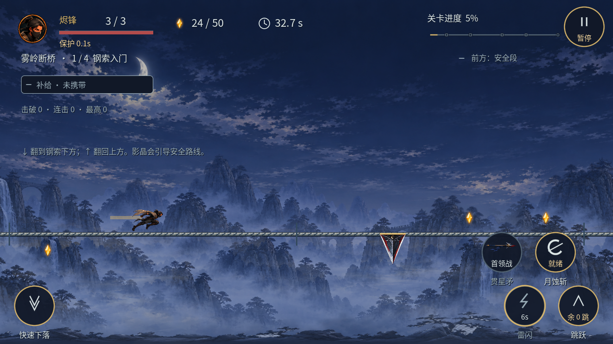
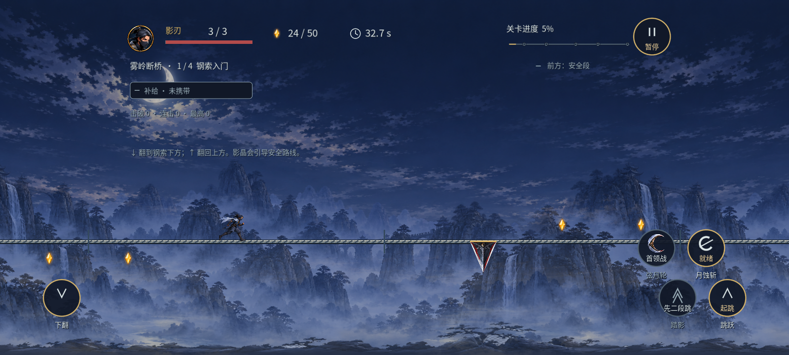

# 战斗 HUD v01 实际截图

2026-11-09，Godot 4.7 / OpenGL Compatibility / Apple M1 Pro，使用正式场景和隔离档案捕获。以下为确定性状态截图，助手图形检查通过；用户运行时视觉和 Android 实机待验收。范围、命令与限制见[任务卡](../README.md)。

| 状态 | 检查点 |
| --- | --- |
| [触屏](hud_route_touch.png) | 顶部悬浮信息、一左四右、圆内状态与圆外名称 |
| [键盘](hud_route_keyboard.png) | 同一动作状态，快捷键位于圆内；触点输入未开启 |
| [1600 宽屏](hud_wide.png) | 居中 HUD、两侧动作、安全留白 |
| [模拟安全区](hud_safe.png) | `Rect2(60,24,1480,648)`，动作及文字在安全区内 |
| [风竹渡](hud_second_level.png) | 五段实际路线节点，无首领信息 |
| [低生命](hud_low_health.png) | 真实受击后 1 / 3、保护与连击中断 |
| [忍术冷却](hud_cooldown.png) | 向上取整剩余秒数、剩余环和不可用态 |
| [首领现身](hud_boss_entrance.png) | 现身阶段、武器等待交战 |
| [首领蓄力](hud_boss_windup.png) | 上侧 / 蓄力时间 / 下翻躲避 |
| [首领攻击](hud_boss_attack.png) | 紧急预警、护甲与实际危险带 |
| [首领弱点](hud_boss_weak.png) | 弱点时间独立显示 |
| [半血强化](hud_boss_enraged.png) | 72 / 180，强化与弱点阶段同时成立 |
| [御风额度](hud_glide_quota.png) | “余 0.8s”与额度圆点，不当作技能冷却 |
| [雷闪冷却](hud_burst_cooldown.png) | 6s、独立图形、实际贯星矛武器 |
| [护身符待触发](hud_guard_waiting.png) | 实际开局消费，尚未触发 |
| [护身符已触发](hud_guard_used.png) | 实际受击触发后更新，生命保留 |
| [回春药已触发](hud_potion_used.png) | 真实恢复后 2 / 3，不重复消费 |

## 触屏

## 键盘

## 首领蓄力

## 首领强化与弱点

## 额度与冷却

## 安全区

