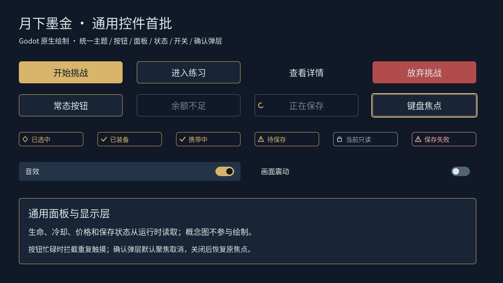
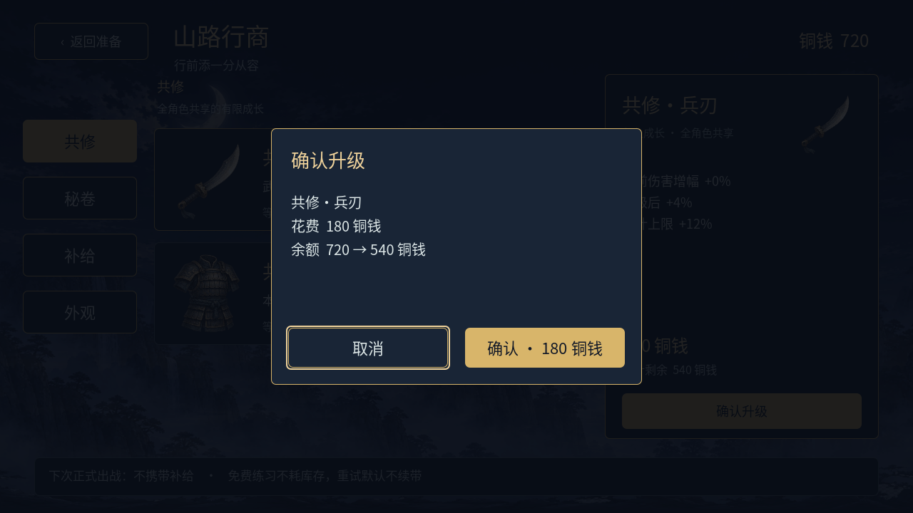
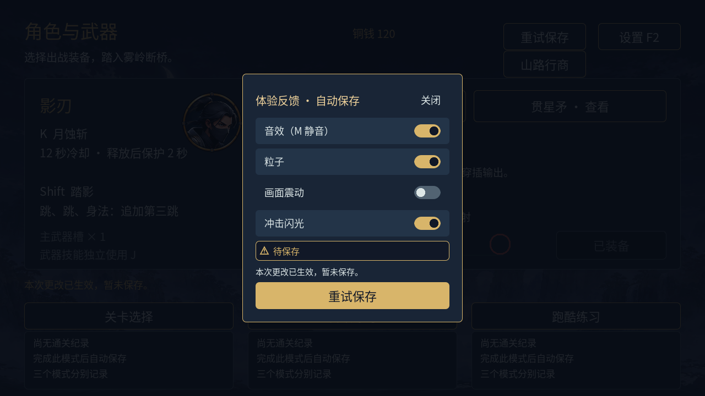

# 通用 UI 首批 · Godot 实际截图

最新第二批准备页截图见 [行前准备 · 卡片 / 页签 / 详情](preparation/README.md)。本页保留首批基础样式截图，旧准备页布局不代表当前正式入口。

2026-11-06。概念审核通过后制作；以下全部由真实 Godot 控件 / 正式场景渲染，1280×720 或 1600×720，未编辑截图像素。采用隔离测试档案，示例余额不代表玩家正式存档。

当前为首批组件的 `visual_review_pending`，用户运行时视觉和 Android 尚待验收；并非 61 类控件和 12 组模板全部完成。

| 截图 | 内容 |
| --- | --- |
| [通用控件](foundation/components_1280.png) | 四种按钮变体、忙碌 / 禁用 / 焦点、状态标识、开关、面板 |
| [商店](foundation/shop_1280.png) | 共用按钮、面板和商品选择 |
| [购买确认](foundation/confirmation_1280.png) | 遮罩、原生文字、默认取消焦点、固定底部操作 |
| [宽屏安全区](foundation/safe_1600.png) | 1600×720，模拟安全区 `Rect2(60,24,1480,648)` |
| [正常设置](foundation/settings_1280.png) | 统一开关与保存标识，全屏遮罩 |
| [设置保存失败](foundation/settings_error_1280.png) | 更改即时生效、待保存和重试，遮罩阻断底层入口 |
| [准备页基础样式](foundation/setup_1280.png) | 旧布局仍保留，基础按钮 / 面板已统一 |
| [暂停基础样式](foundation/pause_1280.png) | 当局只读配置和旧布局仍保留 |
| [HUD](foundation/hud_1280.png) | 保留既有悬浮 HUD 和一左四右布局 |







截图命令：

```sh
/Applications/Godot_mono.app/Contents/MacOS/Godot --path . --fixed-fps 60 \
  --log-file /tmp/ninja-ui-common-render.log \
  --script res://tests/test_ui_components.gd -- \
  --capture-dir=/绝对路径/截图目录
```

仅 `components` 控件展示板在测试脚本内直接组装真实控件，其余均实例化正式场景，无新增 `.tscn`。展示板作为长期共用组件验证工具保留；后续扩展组件继续复用这个入口。
