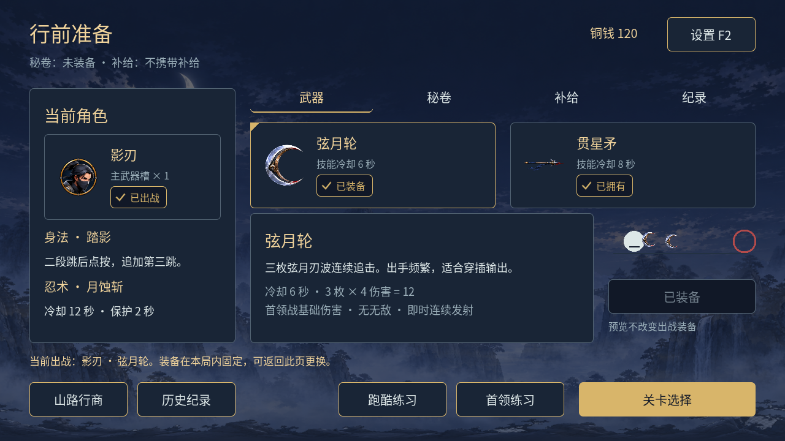
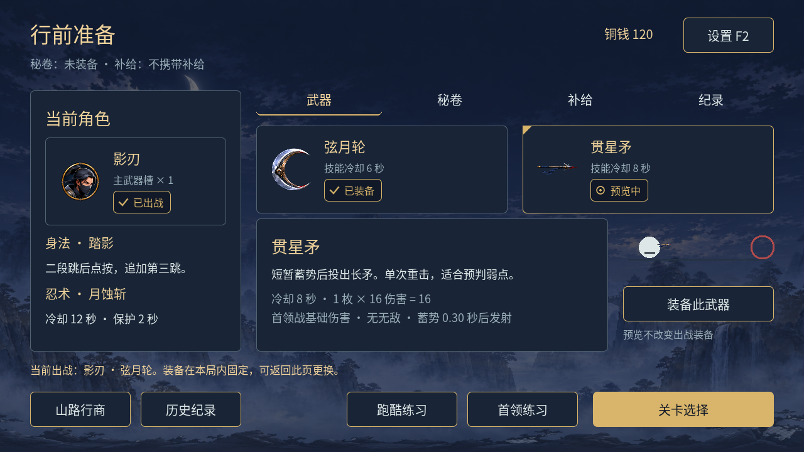

# 行前准备 · 第二批通用 UI 实际截图

2026-11-06，复用已通过的通用 UI v01 制作。以下为正式 `character_setup.tscn` 实际渲染，使用隔离档案，未编辑截图像素。用户运行时视觉 / Android 尚待验收，当前 `visual_review_pending`。

| 截图 | 检查内容 |
| --- | --- |
| [首次进入](preparation_initial.png) | 角色卡、两张武器卡、页签与固定操作区 |
| [武器预览](preparation_preview.png) | 贯星矛预览，弦月轮仍装备，状态独立 |
| [明确装备后](preparation_equipped.png) | 贯星矛已装备，动作禁用避免重复 |
| [秘卷](preparation_scrolls.png) | 实际已购 / 已选秘卷，统一行商入口 |
| [补给](preparation_supplies.png) | 所选物品与真实库存，查看不消费 |
| [模式纪录](preparation_records.png) | 正式三星 / 练习隔离及滚动区域 |
| [较新档案](preparation_readonly.png) | 持久只读标识、可预览但禁止装备 |
| [保存失败](preparation_save_failure.png) | 当前装备内存生效、持续重试保存 |
| [宽屏安全区](preparation_safe.png) | 1600×720，模拟安全区 `Rect2(60,24,1480,648)` |
| [设置弹层](preparation_settings.png) | 统一设置与遮罩，焦点进入关闭按钮 |

本地检查结果、截图哈希与日志见 [验证摘要](../../preparation_validation.json)；[完整回归](../../preparation_regressions.json)。旧首批截图保留历史，不覆盖原证据。
